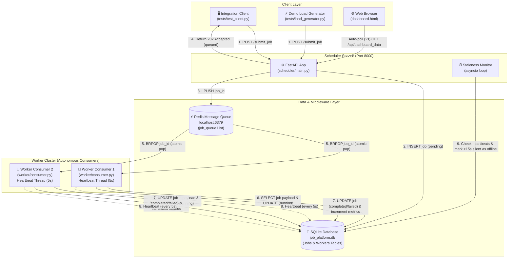

# System Architecture & Technical Design Document

This document provides a comprehensive architectural breakdown of the **Distributed Job Processing Platform**, mapping its engineering components to core **Distributed Systems (CS/IT)** theoretical concepts for academic evaluation and viva defense.

---

## 1. System Architecture Diagram



---

## 2. End-to-End Data Flow Walkthrough

```
Step 1: Submission
Client / Load Generator -> POST /submit_job (JobRequest JSON) -> Scheduler

Step 2: Persistence (Single Source of Truth)
Scheduler -> INSERT INTO jobs (status='pending') -> SQLite (job_platform.db)

Step 3: Asynchronous Dispatch
Scheduler -> LPUSH job_id -> Redis List (job_queue)

Step 4: Immediate Acknowledgment (Producer Decoupling)
Scheduler -> HTTP 202 Accepted (status: 'queued', job_id) -> Client

Step 5: Event-Driven Claim (Competing Consumers)
Worker -> BRPOP job_queue (5s timeout) -> Redis
Redis -> Returns job_id to EXACTLY ONE worker node

Step 6: State Transition to Running
Worker -> SELECT job FROM jobs WHERE job_id = ? -> SQLite
Worker -> UPDATE jobs SET status='running', worker_id=? -> SQLite

Step 7: Task Execution & Outcome Persistence
Worker -> Execute task logic (simulated CPU/IO work)
Worker -> UPDATE jobs SET status='completed', result=? -> SQLite
Worker -> UPDATE workers SET jobs_completed = jobs_completed + 1 -> SQLite

Step 8: Heartbeat Liveness Signal
Worker Daemon Thread -> UPDATE workers SET last_heartbeat=now -> SQLite (every 5s)

Step 9: Autonomous Failure Detection
Scheduler Background Loop -> SELECT * FROM workers WHERE status='online'
If (now - last_heartbeat) > 15s -> UPDATE workers SET status='offline' -> SQLite

Step 10: Real-Time Observability
Browser Dashboard -> GET /api/dashboard_data (every 2s) -> Scheduler
Scheduler -> SELECT aggregated metrics & recent jobs -> Returns JSON -> Browser DOM update
```

---

## 3. Key Design Decisions

| Architectural Decision | Alternative Considered | Engineering Rationale & Trade-off |
|---|---|---|
| **FastAPI over Flask** | Flask + Celery | Built-in Pydantic schema validation, native async `lifespan` support, auto-generated OpenAPI documentation (`/docs`), and low overhead. |
| **Redis List (`LPUSH`/`BRPOP`) over HTTP RPC Push** | Direct HTTP RPC (`POST /execute_job`) | **Location Transparency & Temporal Decoupling**: Scheduler doesn't need worker IP addresses. Jobs remain safely queued even if 0 workers are online. |
| **Blocking Pop (`BRPOP`) over Polling (`RPOP` + `time.sleep`)** | Busy-wait sleep loop | Eliminates CPU & network polling overhead. Workers block at the OS kernel level until Redis pushes data millisecond-instant. |
| **SQLite (Raw SQL) over ORM (SQLAlchemy)** | SQLAlchemy / Tortoise ORM | **Educational Transparency**: Every query is explicit and explainable during a viva. WAL mode (`PRAGMA journal_mode=WAL`) enables concurrent reader throughput. |
| **Dedicated Daemon Thread for Heartbeats** | Inline heartbeat inside main job loop | Prevents long-running task execution (CPU/IO operations) from blocking liveness updates. Liveness continues independently of worker load. |
| **Aggregated API Route (`GET /api/dashboard_data`)** | Multiple REST calls (`/jobs`, `/workers`, `/health`) | Reduces client-server round-trips for the dashboard from 3 calls to 1 atomic payload per polling cycle. |

---

## 4. Distributed Systems Concepts Demonstrated (Viva Reference Guide)

This section maps theoretical concepts directly to exact codebase locations for viva defense:

### Unit 1 — System Architecture & Transparency

* **Client-Server & Multi-Tier Architecture**: Separates presentation (`dashboard.html`), coordination (`scheduler/main.py`), messaging (`queue_client.py`), persistence (`database.py`), and compute (`worker/consumer.py`).
  * *Code Location*: [scheduler/main.py](scheduler/main.py), [worker/consumer.py](worker/consumer.py)
* **Location Transparency**: Producers and Consumers interact solely via logical names (`job_queue`). Neither knows the IP/port of the other.
  * *Code Location*: [common/queue_client.py](common/queue_client.py)
* **System Observability**: Aggregating partitioned state across independent processes into a unified live view without attached debuggers.
  * *Code Location*: [scheduler/main.py](scheduler/main.py), [scheduler/templates/dashboard.html](scheduler/templates/dashboard.html)

### Unit 2 — Inter-Process Communication (IPC)

* **Remote Procedure Call (RPC)**: Synchronous communication pattern (implemented in Stage 1/2 for baseline reference).
  * *Code Location*: [scheduler/client.py](scheduler/client.py), [worker/main.py](worker/main.py)
* **Data Contracts / IDL**: Pydantic models act as an Interface Definition Language enforcing binary/JSON schemas across process boundaries.
  * *Code Location*: [scheduler/models.py](scheduler/models.py), [worker/models.py](worker/models.py)
* **Message-Oriented Middleware (MOM)**: Asynchronous Producer-Consumer queueing decoupling message production from consumption.
  * *Code Location*: [common/queue_client.py](common/queue_client.py), [scheduler/main.py](scheduler/main.py)

### Unit 3 — Coordination, Consistency & Failure Detection

* **Competing Consumers & Lock-Free Mutual Exclusion**: Redis `BRPOP` is an atomic single-key operation, guaranteeing each `job_id` is popped by **exactly one** worker instance without application-level distributed locks.
  * *Code Location*: [common/queue_client.py](common/queue_client.py), [worker/consumer.py](worker/consumer.py)
* **Unreliable Failure Detection (Chandra-Toueg Model)**: In an asynchronous network with no shared physical clock, liveness is detected through periodic heartbeat signals. Silence beyond a threshold (`15s`) marks a worker `offline`.
  * *Code Location*: [common/database.py](common/database.py), [worker/consumer.py](worker/consumer.py), [scheduler/main.py](scheduler/main.py)
* **Persistent Single Source of Truth**: Job state machine transitions (`pending` → `running` → `completed`/`failed`) are logged synchronously in SQLite to prevent loss during process crashes.
  * *Code Location*: [common/database.py](common/database.py)

---

## 5. Known Limitations & Planned Work (FA-2 Roadmap)

This FA-1 submission establishes the foundational RPC, queueing, persistence, health monitoring, and observability layers. The following limitations are explicitly identified and planned for **FA-2 (Unit 3 & 4)**:

1. **Single Point of Failure (Scheduler Node)**:
   - *Current Limitation*: If the Scheduler process crashes, new HTTP job submissions fail (though workers continue processing queued jobs in Redis).
   - *FA-2 Plan*: Implement **Leader Election (Raft / Bully algorithm)** with multiple active-standby Scheduler instances.

2. **Single Point of Failure (Redis Queue)**:
   - *Current Limitation*: Single Redis instance running on port 6379.
   - *FA-2 Plan*: Introduce **Redis Sentinel / Cluster Replication** for queue high availability.

3. **Orphaned Job Recovery on Worker Crash**:
   - *Current Limitation*: If a worker pops a job from Redis and crashes *while* status is `'running'`, the job remains in `'running'` state indefinitely.
   - *FA-2 Plan*: Implement **At-Least-Once Delivery via Redis RPOPLPUSH / RETAIN queues** and Scheduler auto-requeue logic for jobs assigned to `'offline'` workers.

4. **Logical Clock & Event Ordering**:
   - *Current Limitation*: Timestamps rely on local system UTC clocks (susceptible to clock drift across physical machines).
   - *FA-2 Plan*: Implement **Lamport Logical Clocks or Vector Clocks** for strict causal event ordering across distributed workers.

5. **Containerization & Orchestration**:
   - *Current Limitation*: Services are executed manually via virtualenv commands in separate terminal sessions.
   - *FA-2 Plan*: Package services into multi-container **Docker Compose** configurations with automated health probes and scaling profiles.
