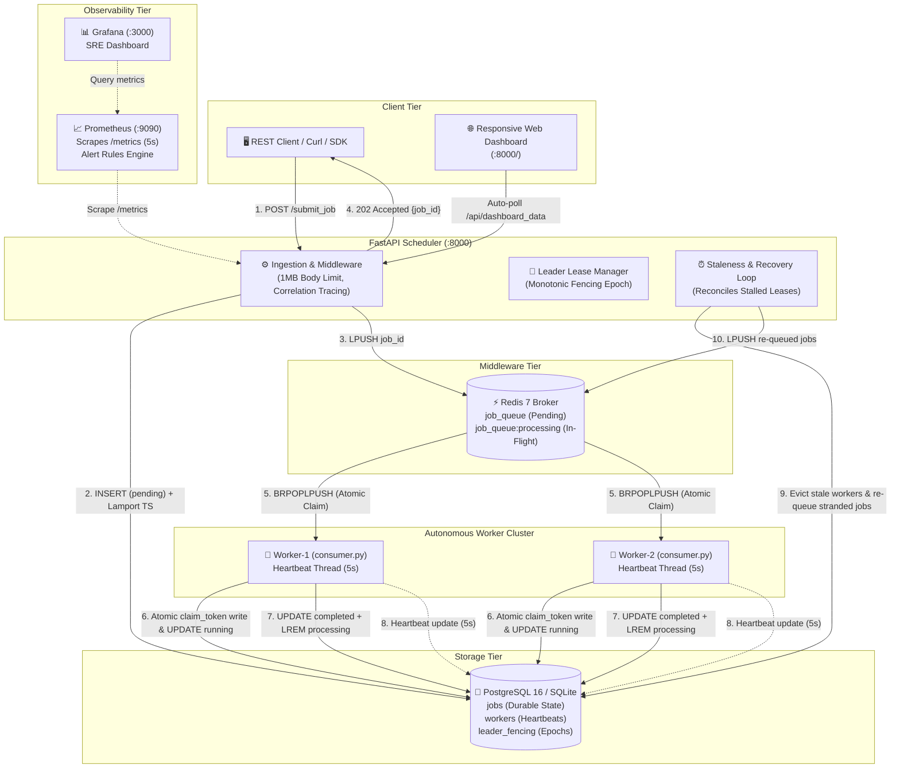

# Distributed Background Job Processing Platform

> **A production-grade, fault-tolerant distributed background job execution platform demonstrating core Distributed Systems principles and emerging paradigms.**

[](https://www.python.org/)
[](https://fastapi.tiangolo.com/)
[](https://www.postgresql.org/)
[](https://redis.io/)
[](https://prometheus.io/)
[](https://grafana.com/)
[](https://docs.docker.com/compose/)
[](tests/)
[](LICENSE)

---

## 📖 Executive Summary

The **Distributed Job Platform** is an enterprise-patterned distributed system engineered to illustrate, test, and prove fundamental theorems of distributed systems (Units I–IV). It pairs an asynchronous job processing system with a formal distributed synchronization suite, networked emerging computing paradigms, comprehensive observability, and fault-injection capabilities.

### Key Capabilities
* **Multi-Container Production Topology (Docker Compose)**: 7 containerized services: PostgreSQL 16 ACID storage, Redis 7 AOF message broker, FastAPI scheduler coordinator, two autonomous worker containers, Prometheus 2.51 metrics scraper, and Grafana 10.4 SRE dashboards.
* **Message-Oriented Delivery (BRPOPLPUSH)**: Redis atomic queue transfers with at-least-once delivery, in-flight processing tracking, and stranded queue reconciliation.
* **Fault-Tolerant Scheduling & Crash Recovery**: Autonomous worker heartbeat failure detector (5s interval, 15s timeout), monotonic leader lease fencing, claim-token fenced execution, and terminal dead-letter triage.
* **Pure CSS Responsive Command Center**: WCAG AA-accessible dark/neon/light themes, viewport reflow down to 320px, controlled table scroller, click-to-copy badges, offline disconnect banners, and `@media (prefers-reduced-motion: reduce)` compliance.
* **SRE Observability & Security Hardening**: Prometheus metrics with bounded cardinality labels, dependency health tracking, Grafana SRE overview dashboard, 5 non-flapping alert rules, `X-Correlation-ID` context propagation, structured secret redaction, defensive input validation (512KB payload limits), and 1MB request body limit middleware (HTTP 413).
* **Distributed Synchronization Suite (Unit III)**: Lamport Clocks, Vector Clocks, Cristian's Physical Time Sync, Garcia-Molina Bully Election, Chang-Roberts Ring Election, Lamport Distributed Mutual Exclusion (with interval non-overlap proof), Chandy-Lamport Distributed Snapshots (token conservation invariant), Wait-For Graph (WFG) Deadlock Detection with victim preemption, and the Beacon Failure Detector protocol.
* **Networked Emerging Paradigms (Unit IV)**:
  - **Distributed Object System**: Genuine HTTP/JSON-RPC client proxy and server skeleton operating across decoupled OS processes with explicit method registration, allowlists, private/dunder rejection, remote exception marshaling, client deadlines/timeouts, and restart recovery.
  - **Networked Distributed File System (DFS)**: Real multi-process storage cluster featuring NameNode metadata coordinator and $\ge 3$ independent DataNodes, block partitioning, SHA-256 integrity verification, $R=2$ replication, single-node crash failover, autonomous self-healing re-replication, bit-rot detection, and explicit unrecoverable data loss reporting.
  - **Serverless Function Runtime Service**: Standalone process-isolated FaaS execution service with strict execution timeout enforcement (`terminate()` + `kill()`), zero unkillable threads, validated invocation schemas, durable SQLite invocation auditing, and persistent idempotency deduplication surviving service restarts.
  - **Web-Based Distributed System**: Tiered FastAPI, Redis, PostgreSQL, and multi-worker architecture with integration tests, error mapping, and dependency outage recovery ([`docs/WEB_DISTRIBUTED_SYSTEM_ARCHITECTURE.md`](docs/WEB_DISTRIBUTED_SYSTEM_ARCHITECTURE.md)).
  - **Industrial Case Studies**: Rigorous, cited academic studies for Megaport, Cloudflare, AWS, Hadoop, Kubernetes, and HDFS ([`docs/CASE_STUDIES.md`](docs/CASE_STUDIES.md)).

---

## ⚡ Clean Environment Setup & Quick Start

### Prerequisites
* **Python**: 3.10 or higher
* **Docker**: Docker Engine 24+ & Docker Compose v2+ (or Docker Desktop)
* **Redis**: Redis 7.0+ (Included via Docker Compose or local executable in `tools/redis/redis-server.exe`)

### Option A: Real Multi-Container Cluster (Docker Compose Workflow)

```bash
# 1. Clone repository into a clean workspace
git clone https://github.com/SwayamMandhani06/distributed-job-platform.git
cd distributed-job-platform

# 2. Configure environment (defaults work out-of-the-box)
cp .env.example .env

# 3. Launch all 7 containers in detached mode
docker compose up -d

# 4. Verify all services are healthy and running
docker compose ps
```

#### Access Points
* 🌐 **Live Web Dashboard:** [http://localhost:8000/](http://localhost:8000/)
* 📊 **Grafana SRE Dashboards:** [http://localhost:3000/](http://localhost:3000/) (User: `admin` / Password: `admin`)
* 📈 **Prometheus Query Console:** [http://localhost:9090/](http://localhost:9090/)
* 📑 **Interactive OpenAPI Docs:** [http://localhost:8000/docs](http://localhost:8000/docs)
* 📡 **Raw Prometheus Metrics:** [http://localhost:8000/metrics](http://localhost:8000/metrics)

---

### Option B: Local Lightweight Development (Zero-Docker Disposable Mode)

For local offline development without Docker, the platform automatically falls back to SQLite (WAL mode):

```bash
# 1. Create and activate virtual environment
python -m venv venv
.\venv\Scripts\activate          # Windows PowerShell / CMD
# source venv/bin/activate       # macOS / Linux

# 2. Install dependencies
pip install -r requirements.txt

# 3. Start local Redis server
.\tools\redis\redis-server.exe .\tools\redis\redis.windows.conf

# 4. Launch Scheduler Coordinator (Terminal 1)
python -m uvicorn scheduler.main:app --port 8000

# 5. Launch Worker Consumer (Terminal 2)
python -m worker.consumer
```

---

## 🛠️ Cluster Lifecycle & Environment Commands

| Operation | Docker Compose Command | Local Disposable Dev Command | Purpose / Behavior |
| :--- | :--- | :--- | :--- |
| **Start** | `docker compose up -d` | Launch Redis, Scheduler, and Worker | Boots cluster; checks health checks and dependency retries. |
| **Stop** | `docker compose down` | `Ctrl+C` in running terminals | Gracefully terminates processes; flushes AOF buffers to disk. |
| **Rebuild** | `docker compose up -d --build` | `pip install -r requirements.txt` | Rebuilds container images with fresh code while keeping volumes. |
| **Reset** | `docker compose down -v` | Delete `job_platform.db` & flush Redis | **Destructive Reset**: Purges all persistent database and queue state. |
| **Logs** | `docker compose logs -f [service]` | View terminal stdout | Streams structured logs with correlation IDs (`corr=...`). |
| **Migrate** | `python -m tools.migrate_sqlite_to_postgres` | Auto on boot | Idempotently migrates SQLite jobs/workers to PostgreSQL. |

---

## 🏛️ System Architecture & Data Flow



### Component Responsibilities
* **FastAPI Scheduler (`scheduler/main.py`)**: Request ingestion, schema validation, 1MB body limit enforcement, correlation tracing, leader lease renewals, stale worker eviction, orphaned job recovery, Prometheus `/metrics` exposition, and static dashboard serving.
* **Autonomous Workers (`worker/consumer.py`)**: Asynchronous job popping via `BRPOPLPUSH`, atomic database claim acquisition with UUID `claim_token`, execution dispatching (`worker/handlers.py`), claim-token fenced result updates, acknowledgment via processing queue eviction, and background heartbeat emission every 5s.
* **PostgreSQL 16 Engine (`common/database.py`)**: Authoritative relational storage with ACID guarantees, monotonic leader epoch fencing (`leader_fencing` table), worker heartbeat registry, and audit history.
* **Redis 7 Broker (`common/queue_client.py`)**: Ephemeral message queue with AOF persistence, atomic queue transfer primitives (`BRPOPLPUSH`), and distributed lease locking (`common/leader_lease.py`).
* **Prometheus & Grafana**: Continuous scraping (5s interval) of platform metrics, latency distributions, worker status, and alert evaluation.

### Step-by-Step Data Flow
1. **Submission**: Client issues `POST /submit_job` with a JSON payload. The scheduler validates the schema against Pydantic constraints, stamps a monotonic Lamport timestamp $L\#$, inserts a `pending` row into PostgreSQL, pushes the `job_id` into Redis `job_queue`, and returns HTTP `202 Accepted` with a correlation ID.
2. **Reliable Claim**: An idle worker process issues a blocking `BRPOPLPUSH job_queue job_queue:processing 2`. When popped, Redis atomically transfers the job ID to the processing list.
3. **Atomic Execution Claim**: The worker issues a conditional SQL `UPDATE jobs SET status='running', worker_id=:wid, claim_token=:token WHERE status='pending'` inside a transaction. If the claim succeeds, it executes the handler.
4. **Completion & Fencing**: The worker computes the task output and updates PostgreSQL: `UPDATE jobs SET status='completed', result=:res WHERE job_id=:id AND claim_token=:token`. If a network partition delayed the worker beyond its lease and the scheduler already reassigned the job, the update is safely rejected.
5. **Acknowledgment**: Following durable database persistence, the worker removes the job ID from `job_queue:processing` via Redis `LREM`.

---

## 📡 REST API Documentation & Examples

### 1. Submit Background Job
* **Endpoint:** `POST /submit_job`
* **Headers:** `Content-Type: application/json`
* **Request:**
  ```bash
  curl -s -X POST http://localhost:8000/submit_job \
    -H "Content-Type: application/json" \
    -d '{"job_type": "math_prime_sieve", "payload": {"limit": 100}}'
  ```
* **Response (HTTP 202 Accepted):**
  ```json
  {
    "job_id": "f8a12e34-5678-4abc-9def-0123456789ab",
    "status": "queued",
    "message": "Job successfully accepted and enqueued into Redis message queue.",
    "correlation_id": "corr-4a8f9c12"
  }
  ```

### 2. Query Job Status & Result
* **Endpoint:** `GET /jobs/{job_id}`
* **Request:**
  ```bash
  curl -s http://localhost:8000/jobs/f8a12e34-5678-4abc-9def-0123456789ab
  ```
* **Response (HTTP 200 OK):**
  ```json
  {
    "job_id": "f8a12e34-5678-4abc-9def-0123456789ab",
    "job_type": "math_prime_sieve",
    "status": "completed",
    "submitted_at": "2026-10-14T01:45:36.123456+00:00",
    "started_at": "2026-10-14T01:45:36.145678+00:00",
    "completed_at": "2026-10-14T01:45:36.189012+00:00",
    "worker_id": "worker-1",
    "retry_count": 1,
    "max_retries": 3,
    "lamport_ts": 45,
    "result": "{\"limit\": 100, \"total_primes\": 25, \"primes_sample\": [2, 3, 5, 7, 11]}",
    "error_message": null
  }
  ```

### 3. Health & Cluster Status
* **Endpoint:** `GET /health`
* **Request:**
  ```bash
  curl -s http://localhost:8000/health
  ```
* **Response (HTTP 200 OK):**
  ```json
  {
    "service": "scheduler",
    "status": "healthy",
    "pending_queue_length": 0,
    "total_workers": 2,
    "online_workers": 2,
    "leader": {
      "is_leader": true,
      "current_leader": "scheduler-master",
      "lease_ttl_seconds": 9.4
    }
  }
  ```

### 4. Prometheus Metrics
* **Endpoint:** `GET /metrics`
* **Response Format:** OpenMetrics / Prometheus standard text
  ```text
  # HELP job_platform_jobs_total Total jobs by terminal status
  # TYPE job_platform_jobs_total counter
  job_platform_jobs_total{status="completed"} 25
  job_platform_jobs_total{status="failed"} 0
  job_platform_jobs_total{status="dead_letter"} 1
  # HELP job_platform_dependency_health Health status of external dependencies (1=healthy, 0=unhealthy)
  # TYPE job_platform_dependency_health gauge
  job_platform_dependency_health{dependency="database"} 1
  job_platform_dependency_health{dependency="redis"} 1
  ```

---

## ⚙️ Environment Configuration Reference

| Environment Variable | Default Value | Description |
|---|---|---|
| `DATABASE_URL` | `sqlite:///job_platform.db` | PostgreSQL (`postgresql://...`) or SQLite connection string. |
| `REDIS_HOST` | `localhost` | Redis server hostname. |
| `REDIS_PORT` | `6379` | Redis server port. |
| `QUEUE_NAME` | `job_queue` | Redis list key for pending job dispatches. |
| `PROCESSING_QUEUE_NAME`| `job_queue:processing` | Redis list key for in-flight jobs (`BRPOPLPUSH`). |
| `WORKER_ID` | `worker-<uuid>` | Unique worker identifier. |
| `HEARTBEAT_INTERVAL_SECONDS` | `5.0` | Frequency of worker heartbeat ping to database. |
| `WORKER_STALENESS_TIMEOUT_SECONDS` | `15.0` | Inactivity threshold before marking worker `offline`. |
| `JOB_LEASE_TIMEOUT_SECONDS` | `30.0` | Maximum job execution duration before reclaim. |
| `SCHEDULER_ID` | `scheduler-<uuid>` | Unique identifier of scheduler coordinator instance. |
| `LEADER_LEASE_TTL_SECONDS` | `10.0` | Distributed leader lease TTL key in Redis. |

---

## 🗄️ Database Migrations & Durability

The platform includes automated, idempotent schema migrations executed automatically upon process startup in [`common/database.py`](common/database.py):
* **Schema Version Tracking**: Managed via `schema_migrations` table.
* **Column Inspection**: Dynamically inspects existing tables (`PRAGMA table_info` in SQLite, `information_schema.columns` in PostgreSQL) and applies missing columns:
  - `jobs`: `retry_count`, `max_retries`, `claimed_at`, `lease_expires_at`, `claim_token`, `lamport_ts`.
  - `workers`: `pid`, `startup_time`, `current_job_id`.
  - `leader_fencing`: `scope`, `leader_id`, `epoch`, `updated_at`.
* **Zero-Downtime Migration Utility**: [`tools/migrate_sqlite_to_postgres.py`](tools/migrate_sqlite_to_postgres.py) migrates SQLite data into PostgreSQL with conflict resolution (`ON CONFLICT DO UPDATE`).

---

## 🔬 Syllabus Concepts: Unit III — Synchronization

> 📄 **Comprehensive Audit Report**: See [docs/UNIT3_SYNCHRONIZATION_AUDIT.md](docs/UNIT3_SYNCHRONIZATION_AUDIT.md) for complete mathematical proofs, protocol traces, and failure assumptions.

| Topic / Requirement | Algorithm / Protocol | Implementation Files | Process / Network Boundary | Automated Tests & Verification | Evidence & Correctness Guarantees | Known Limitations |
|---|---|---|---|---|---|---|
| **Physical Clock Synchronization** | **Cristian's Algorithm** (1989) | [`common/cristian.py`](common/cristian.py)<br/>[`scheduler/main.py`](scheduler/main.py) | Client process $\leftrightarrow$ Scheduler HTTP endpoint (`/api/time`) | `pytest tests/test_clocks_and_sync.py`<br/>`python tools/sync_cristian.py` | Accurate offset estimation $\theta = T_s + \frac{RTT}{2} - T_1$ with uncertainty $\pm \frac{RTT}{2}$; distinguishes software offset from kernel clock adjustment. | Assumes symmetric network latency ($t_{req} \approx t_{resp}$); asymmetric routes introduce error. |
| **Logical Clocks** | **Lamport Logical Clocks** (1978) | [`common/clocks.py`](common/clocks.py)<br/>[`scheduler/main.py`](scheduler/main.py) | Integrated into real HTTP scheduler requests and worker database claims | `pytest tests/test_clocks_and_sync.py`<br/>`GET /api/clocks/lamport_trace` | Scalar monotonic ordering $L_j = \max(L_j, L_{msg}) + 1$; proves causal precedence without global shared clock. | Partial order only; $L_a < L_b$ does not guarantee that $a$ causally caused $b$. |
| **Vector Clocks** | **Mattern & Fidge Vector Clocks** (1988) | [`common/clocks.py`](common/clocks.py) | Inter-process vector exchange endpoint (`/api/clocks/vector/exchange`) | `pytest tests/test_clocks_and_sync.py`<br/>`python tools/vector_clock_demo.py` | Exact causal concurrency detection ($V_A < V_B$ vs $V_A \parallel V_B$) with dynamic membership management. | Vector size scales linearly $O(N)$ with process cluster membership. |
| **Leader Election (Bully)** | **Garcia-Molina Bully Algorithm** (1982) | [`common/election_transport.py`](common/election_transport.py)<br/>[`common/election_bully.py`](common/election_bully.py) | 4 independent OS processes on TCP ports 9111–9114 | `pytest tests/test_multiprocess_elections.py`<br/>`python tools/bully_multiprocess_demo.py` | Highest-priority live process wins; higher-priority node preempts/bullies lower coordinator upon restart. | Message complexity $O(N^2)$ in worst case; sensitive to transient network partitions. |
| **Leader Election (Ring)** | **Chang & Roberts Ring Algorithm** (1979) | [`common/election_transport.py`](common/election_transport.py)<br/>[`common/election_ring.py`](common/election_ring.py) | 4 independent OS processes on TCP ports 9211–9214 | `pytest tests/test_multiprocess_elections.py`<br/>`python tools/ring_multiprocess_demo.py` | Unidirectional ring candidate circulation; automatic dead-successor socket bypass on connection failure. | Unidirectional ring topology assumes reliable successor reachability. |
| **Distributed Mutual Exclusion** | **Lamport Distributed Mutex** (1978) | [`common/mutex_transport.py`](common/mutex_transport.py)<br/>[`common/mutual_exclusion.py`](common/mutual_exclusion.py) | 3 independent OS processes on TCP ports 9311–9313 | `pytest tests/test_mutual_exclusion.py`<br/>`python tools/mutex_multiprocess_demo.py` | Total ordering $(L_i, P_i)$; mathematical interval proof that no two critical sections overlap: $\max(t_{enter}^A, t_{enter}^B) \ge \min(t_{exit}^A, t_{exit}^B)$. | Blocks indefinitely on node crash unless failure detector evicts dead participant. |
| **Global State & Snapshots** | **Chandy-Lamport Algorithm** (1985) | [`common/snapshot_transport.py`](common/snapshot_transport.py)<br/>[`common/snapshot_chandy_lamport.py`](common/snapshot_chandy_lamport.py) | 3 independent OS processes on TCP ports 9411–9413 | `pytest tests/test_unit3_advanced.py`<br/>`python tools/snapshot_multiprocess_demo.py` | Strictly FIFO logical channels; records local states and in-flight tokens; proves token conservation invariant (total tokens conserved). | Requires reliable FIFO communication channels. |
| **Deadlock Detection** | **Centralized Wait-For Graph (WFG)** | [`common/deadlock_wfg.py`](common/deadlock_wfg.py) | Concurrent multi-threaded task coordinator | `pytest tests/test_unit3_advanced.py`<br/>`python tools/deadlock_concurrent_demo.py` | DFS 3-color cycle detection; safe victim preemption with resource release (`TaskAbortedException`). | Centralized WFG coordinator is a potential single point of failure. |
| **Failure Detection** | **Beacon Protocol** | [`common/beacon_transport.py`](common/beacon_transport.py)<br/>[`common/beacon_protocol.py`](common/beacon_protocol.py) | Independent monitor & emitter processes on TCP port 9511 | `pytest tests/test_unit3_advanced.py`<br/>`python tools/beacon_multiprocess_demo.py` | Multi-tier state transitions (`HEALTHY` $\to$ `SUSPECTED` $\to$ `DEAD`) with recovery refutation upon beacon arrival. | Subject to FLP impossibility: asynchronous delay cannot be definitively distinguished from crash. |

---

## 🌐 Syllabus Concepts: Unit IV — Emerging Paradigms

> 📄 **Technical Reference**: See [`docs/WEB_DISTRIBUTED_SYSTEM_ARCHITECTURE.md`](docs/WEB_DISTRIBUTED_SYSTEM_ARCHITECTURE.md) and [`docs/CASE_STUDIES.md`](docs/CASE_STUDIES.md).

| Topic / Requirement | Paradigm / Architecture | Implementation Files | Process / Network Boundary | Automated Tests & Verification | Evidence & Correctness Guarantees | Known Limitations |
|---|---|---|---|---|---|---|
| **Distributed Object Systems** | **Networked Remote Object & Proxy** | [`common/distributed_object.py`](common/distributed_object.py) | Client Proxy $\leftrightarrow$ HTTP/TCP JSON-RPC Server Skeleton across OS processes | `pytest tests/test_unit4_multiprocess_paradigms.py`<br/>`python tools/remote_object_multiprocess_demo.py` | Explicit allowlist method registration; private/dunder invocation rejection; remote exception marshaling; strict client deadlines; restart recovery. | Does not implement full distributed garbage collection or distributed object activation. |
| **Distributed File Systems** | **Decoupled Metadata & Storage Cluster** | [`common/dfs_transport.py`](common/dfs_transport.py)<br/>[`common/distributed_filesystem.py`](common/distributed_filesystem.py) | NameNode coordinator (port 9830) + 3 independent DataNodes (ports 9831–9833) | `pytest tests/test_unit4_multiprocess_paradigms.py`<br/>`python tools/dfs_multiprocess_demo.py` | Metadata/content decoupling; block partitioning; SHA-256 integrity verification; $R=2$ replication; single-node failure failover; autonomous re-replication; bit-rot detection; explicit unrecoverable data loss reporting. | Fixed block size (64B demo, configurable); not intended as a drop-in POSIX filesystem. |
| **Serverless Computing** | **Process-Isolated FaaS Runtime Service** | [`common/serverless_runtime.py`](common/serverless_runtime.py) | Standalone HTTP FaaS Service (port 9840) $\leftrightarrow$ Spawned Worker Processes | `pytest tests/test_unit4_multiprocess_paradigms.py`<br/>`python tools/serverless_service_demo.py` | OS child process isolation; strict timeout kill (`terminate()` + `kill()`); zero unkillable threads; durable SQLite idempotency caching surviving restarts. | Handlers must be pickleable callables across process boundaries on Windows. |
| **Web-Based Distributed Systems** | **Tiered Distributed Architecture** | [`scheduler/main.py`](scheduler/main.py)<br/>[`worker/consumer.py`](worker/consumer.py) | FastAPI Gateway $\leftrightarrow$ Redis Broker $\leftrightarrow$ PostgreSQL $\leftrightarrow$ Workers | `pytest tests/test_cluster_integration.py`<br/>`python tools/web_architecture_demo.py` | REST API gateway, decoupled asynchronous workers, resilient claim fencing, and dependency health tracking. | Dependent on network partition boundary defenses between coordinator and database. |
| **Industrial Case Studies** | **Megaport, Cloudflare, AWS, Hadoop, Kubernetes, HDFS** | [`docs/CASE_STUDIES.md`](docs/CASE_STUDIES.md) | Literature review and academic analysis | Peer-reviewed citations and RFC references in documentation | Grounded in primary sources; clearly separates documented industry architectures from project executable claims. | Case study documentation only; not executable production deployments of third-party platforms. |

---

## 🧪 Comprehensive Automated Testing & Validation

The test suite consists of **206 automated tests** with 100% pass rate.

```bash
# Run the entire test suite
pytest -v

# Run Phase 8 Comprehensive 14-Scenario End-to-End Verification Harness
python tools/e2e_verification_harness.py
```

### Targeted Test Suites
```bash
# Unit IV Multi-Process Networked Paradigms (RPC, DFS Cluster, Serverless)
pytest tests/test_unit4_multiprocess_paradigms.py -v

# Unit III Multi-Process Networked Synchronization (Mutex, Snapshots, Deadlock, Beacon)
pytest tests/test_unit3_multiprocess_sync.py -v

# Unit III Multi-Process Networked Elections (Bully & Ring)
pytest tests/test_multiprocess_elections.py -v

# Unit III Clocks, Timestamp Invariants & Synchronization
pytest tests/test_clocks_and_sync.py -v

# Unit III Advanced Invariants (Snapshots, Deadlock WFG, Beacon)
pytest tests/test_unit3_advanced.py -v

# Unit III Mutual Exclusion Safety & Ordering
pytest tests/test_mutual_exclusion.py -v

# Queue Reliability, Worker Crash Recovery & Token Fencing
pytest tests/test_reliability_hardening.py -v

# Phase 6 Responsive UI & Accessibility
pytest tests/test_dashboard_ui_responsiveness.py -v

# Phase 7 Observability, Security & Operational Hardening
pytest tests/test_observability_and_security.py -v
```

---

## 💥 Fault-Injection & Algorithm Demonstrations

Every Unit III and Unit IV algorithm can be executed standalone over real OS processes and network sockets:

```bash
# 1. Live Worker Crash & Stale Lease Recovery Demo
python tools/demonstrate_crash_recovery.py

# 2. Garcia-Molina Bully Election over 4 TCP Ports
python tools/bully_multiprocess_demo.py

# 3. Chang-Roberts Ring Election with Dead Successor Bypass
python tools/ring_multiprocess_demo.py

# 4. Lamport Mutual Exclusion with Interval Overlap Proof
python tools/mutex_multiprocess_demo.py

# 5. Chandy-Lamport Distributed Snapshot with Token Conservation
python tools/snapshot_multiprocess_demo.py

# 6. Centralized Wait-For Graph (WFG) Deadlock Detection & Preemption
python tools/deadlock_concurrent_demo.py

# 7. Beacon Failure Detector with Suspicion & Recovery
python tools/beacon_multiprocess_demo.py

# 8. Networked Distributed Object RPC System
python tools/remote_object_multiprocess_demo.py

# 9. Networked Distributed File System (DFS) Cluster (R=2 Failover)
python tools/dfs_multiprocess_demo.py

# 10. Serverless Computing Runtime Service (Timeout Kill & Idempotency)
python tools/serverless_service_demo.py

# 11. Cristian Physical Clock Synchronization
python tools/sync_cristian.py --simulate

# 12. Vector Clock Dynamic Membership & Causality Trace
python tools/vector_clock_demo.py
```

---

## 📊 Monitoring & Alerting Setup

### Prometheus Configuration (`prometheus.yml` & `prometheus/alert_rules.yml`)
* **Scrape Target**: `scheduler:8000/metrics` every 5 seconds.
* **5 Actionable Prometheus Alerts**:
  1. `DistributedJobPlatformDown`: Fires if scheduler endpoint is unreachable for >15s.
  2. `WorkerClusterDegraded`: Fires if fewer than 2 workers are active for >30s.
  3. `DeadLetterRateElevated`: Fires if jobs transition to `dead_letter` (>0 over 1m).
  4. `RedisBrokerUnreachable`: Fires if scheduler reports Redis dependency health = 0.
  5. `JobExecutionLatencyElevated`: Fires if 95th percentile execution latency exceeds 10s.

### Grafana Dashboard (`grafana/dashboards/distributed_job_platform_overview.json`)
* Automatically provisioned datasource (Prometheus) and dashboard on port 3000.
* Panels: Real-time Job Ingestion Rate, State Distributions, Worker Pool Liveness, P95/P50 Latencies, Redis/Database Dependency Health, and Dead-Letter Triage Counter.

---

## 🎓 Faculty Assessment & Viva Demonstration Playbook

Follow this 5-minute step-by-step sequence for faculty evaluation:

### Step 1: Clean Environment & Dashboard Overview (1 Min)
1. Show running cluster: `docker compose ps` (all 7 containers healthy).
2. Open dashboard: [http://localhost:8000/](http://localhost:8000/).
3. Highlight theme switcher (Dark, Neon, Light), responsive layout, and active Leader Lease badge showing Monotonic Epoch.

### Step 2: Normal Job Processing & Causal Ordering (1 Min)
1. Submit valid job via curl:
   ```bash
   curl -s -X POST http://localhost:8000/submit_job -H "Content-Type: application/json" -d '{"job_type": "math_prime_sieve", "payload": {"limit": 500}}'
   ```
2. Point out HTTP 202 Accepted, incrementing Lamport timestamp $L\#$, and immediate worker pickup on the dashboard.

### Step 3: Fault Injection — Worker Crash Recovery (1.5 Min)
1. Run live crash recovery demonstration:
   ```bash
   python tools/demonstrate_crash_recovery.py
   ```
2. Explain: Worker 1 claims job with a short lease and abruptly crashes (SIGKILL).
3. The scheduler's background staleness monitor detects the expired lease, increments the retry counter, resets the status to `pending`, and Worker 2 claims and completes the job.
4. Part B shows a poison job exhausting `max_retries` ($3/3$) and safely moving to `dead_letter`.

### Step 4: Unit III Synchronization — Lamport Mutex & Elections (1 Min)
1. Run Lamport Mutual Exclusion proof:
   ```bash
   python tools/mutex_multiprocess_demo.py
   ```
2. Show mathematical proof of zero interval overlap: $\max(t_{enter}^A, t_{enter}^B) \ge \min(t_{exit}^A, t_{exit}^B)$.
3. Run Bully Election: `python tools/bully_multiprocess_demo.py` showing coordinator crash and high-priority recovery bullying.

### Step 5: Unit IV Emerging Paradigms & Final Test Suite (0.5 Min)
1. Run DFS failover demo: `python tools/dfs_multiprocess_demo.py` (shows NameNode/DataNode separation, DataNode death, transparent failover read, and self-healing).
2. Run full automated test suite to prove submission readiness:
   ```bash
   python tools/e2e_verification_harness.py
   ```
3. Show all 14 scenarios passing: `OVERALL E2E VALIDATION: 14/14 SCENARIOS PASSED`.

---

## 📜 Documentation Directory

* 📑 **[Operational Runbook (docs/OPERATIONS.md)](docs/OPERATIONS.md)**: Cluster commands, health checks, and administration.
* 🛡️ **[Security & Operational Hardening (docs/SECURITY_AND_OPERATIONAL_HARDENING.md)](docs/SECURITY_AND_OPERATIONAL_HARDENING.md)**: Input validation, rate limiting, and secret redaction.
* 🔬 **[Unit III Synchronization Audit (docs/UNIT3_SYNCHRONIZATION_AUDIT.md)](docs/UNIT3_SYNCHRONIZATION_AUDIT.md)**: Deep dive into Clocks, Mutex, Snapshots, and Deadlock.
* 🌐 **[Web Distributed System Architecture (docs/WEB_DISTRIBUTED_SYSTEM_ARCHITECTURE.md)](docs/WEB_DISTRIBUTED_SYSTEM_ARCHITECTURE.md)**: Tiered architecture and error contracts.
* 📚 **[Industrial Case Studies (docs/CASE_STUDIES.md)](docs/CASE_STUDIES.md)**: Rigorous academic analysis of AWS, Cloudflare, Megaport, Hadoop, and Kubernetes.
* 📦 **[PostgreSQL Persistence Migration (docs/PERSISTENCE_MIGRATION_POSTGRESQL.md)](docs/PERSISTENCE_MIGRATION_POSTGRESQL.md)**: Zero-downtime database migration guide.

---

## 📄 License

This project is licensed under the MIT License — see the [LICENSE](LICENSE) file for details.
