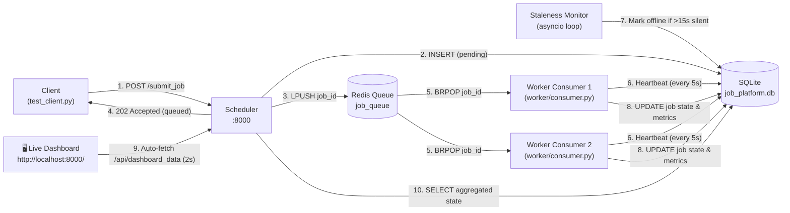

# Distributed Background Job Processing Platform

> **A production-grade, fault-tolerant background job distribution system demonstrating core Distributed Systems principles.**

[](https://www.python.org/)
[](https://fastapi.tiangolo.com/)
[](https://redis.io/)
[](https://www.sqlite.org/)
[](LICENSE)
[](#roadmap)

The platform demonstrates foundational distributed systems concepts — **RPC inter-service communication**, **persistent distributed state**, **message-oriented middleware**, **heartbeat failure detection**, and **real-time system observability** — through an extensible Scheduler/Worker architecture.

---

## ⚡ Quick Start (< 2 Minutes)

```bash
# 1. Start Redis container
docker start redis-server || docker run -d --name redis-server -p 6379:6379 redis:latest

# 2. Setup Virtual Environment & Dependencies
python -m venv venv
# Windows: venv\Scripts\activate | macOS/Linux: source venv/bin/activate
pip install -r requirements.txt

# 3. Terminal 1: Start Scheduler & Dashboard
uvicorn scheduler.main:app --port 8000

# 4. Terminal 2: Start Compute Worker
python -m worker.consumer

# 5. Terminal 3: Run Integration Test Client
python -m tests.test_client
```
👉 Open Live Dashboard: **[http://localhost:8000/](http://localhost:8000/)**

---

## 📚 Documentation Index

- 📑 **[System Architecture & Technical Design (ARCHITECTURE.md)](ARCHITECTURE.md)** — Polished Mermaid diagrams, data flow step-by-step, design trade-offs, syllabus concept mappings, and FA-2 roadmap.
- 🎬 **[Live Presentation & Demo Script (DEMO_SCRIPT.md)](DEMO_SCRIPT.md)** — Step-by-step viva presentation playbook, terminal commands, spoken script, worker failure finale, and troubleshooting guide.
- ⚙️ **[Environment Configuration (.env.example)](.env.example)** — List of all configurable environment variables.

---

## 📋 Table of Contents

- [Quick Start](#-quick-start--2-minutes)
- [Architecture Overview](#architecture-overview)
- [Project Structure](#project-structure)
- [Running the Platform](#running-the-platform)
- [Distributed Systems Concepts Summary](#distributed-systems-concepts-summary-fa-1-complete)
- [Roadmap](#roadmap)
- [License](#license)

---

## Architecture Overview



---

## Project Structure

```
distributed-job-platform/
├── common/
│   ├── __init__.py
│   ├── config.py          # Centralized configuration & environment settings
│   ├── database.py        # SQLite persistence layer for jobs & worker registry (raw SQL)
│   ├── logging_config.py  # Shared structured logging setup
│   └── queue_client.py    # Redis message queue client wrapper (LPUSH/BRPOP)
├── scheduler/
│   ├── __init__.py
│   ├── main.py            # FastAPI app — job submission, async dispatch, heartbeat monitor & dashboard API
│   ├── models.py          # Pydantic models (JobRequest, JobResponse)
│   ├── client.py          # Legacy RPC client helper (Stage 1)
│   └── templates/
│       └── dashboard.html # Single-page live-updating dark web dashboard (Stage 5)
├── worker/
│   ├── __init__.py
│   ├── consumer.py        # Background task worker consumer with heartbeat thread (Stage 3+)
│   ├── main.py            # Legacy FastAPI HTTP worker endpoint (Stage 1/2)
│   └── models.py          # Pydantic models (WorkerResponse)
├── tests/
│   └── test_client.py     # Integration test — submits, polls jobs, and checks worker health
├── .env.example           # Environment variables configuration template
├── ARCHITECTURE.md        # Technical design & syllabus concept mapping guide
├── DEMO_SCRIPT.md         # Live viva presentation script & troubleshooting guide
├── LICENSE                # MIT License
├── requirements.txt       # Pinned dependencies
├── .gitignore
└── README.md
```

---

## Running the Platform

### 1. Start the Scheduler & Live Dashboard (Terminal 1)

```bash
uvicorn scheduler.main:app --port 8000 --reload
```

- **Live Web Dashboard:** [http://localhost:8000/](http://localhost:8000/)
- **Interactive OpenAPI Docs:** [http://localhost:8000/docs](http://localhost:8000/docs)

### 2. Start Worker Consumer(s) (Terminal 2 & optional Terminal 3)

```bash
python -m worker.consumer
```

### 3. Run the Integration & Health Test (Terminal 4)

```bash
python -m tests.test_client
```

---

## Distributed Systems Concepts Summary 

| Stage | Distributed System Concept | Implementation Details | Syllabus Unit |
|---|---|---|---|
| **Stage 1** | **Remote Procedure Call (RPC)** | Scheduler invokes worker endpoints synchronously over HTTP with typed Pydantic data contracts acting as an Interface Definition Language (IDL). | Unit 2 (Communication) |
| **Stage 1** | **Service Decomposition** | Coordinator and worker nodes run as independent processes with distinct lifecycles on separate network ports. | Unit 1 (Architecture) |
| **Stage 2** | **Persistent Distributed State** | Single source of truth in SQLite (`job_platform.db`). Job transitions (`pending` → `running` → `completed`) survive process crashes. | Unit 3 (Persistence) |
| **Stage 2** | **Crash Safety** | Job metadata is inserted *before* task dispatch, guaranteeing auditability even during unexpected crashes. | Unit 3 (Fault Tolerance) |
| **Stage 3** | **Message-Oriented Middleware** | Redis list acts as an asynchronous producer-consumer message queue (`LPUSH` / `BRPOP`). | Unit 2 (Communication) |
| **Stage 3** | **Location Transparency & Elasticity** | Scheduler needs no worker IP addresses. Autonomous consumers scale horizontally by connecting to Redis. | Unit 1 (Architecture) |
| **Stage 3** | **Competing Consumers** | Redis `BRPOP` is atomic, guaranteeing zero duplicate processing across concurrent workers without application locks. | Unit 3 (Mutual Exclusion) |
| **Stage 4** | **Unreliable Failure Detection** | Heartbeat pattern (Chandra-Toueg model). Workers deliver 5s liveness signals on a non-blocking background daemon thread. | Unit 3 (Failure Detectors) |
| **Stage 4** | **Staleness Monitoring** | Scheduler runs an `asyncio` background loop marking silent workers (`>15s`) as `offline`. | Unit 3 (Health Checking) |
| **Stage 5** | **System Observability** | Single-page live dashboard (`GET /`) aggregating partitioned state from multiple independent processes into a unified view. | Unit 1 & 3 (Observability) |


## License

This project is licensed under the MIT License — see the [LICENSE](LICENSE) file for details.
