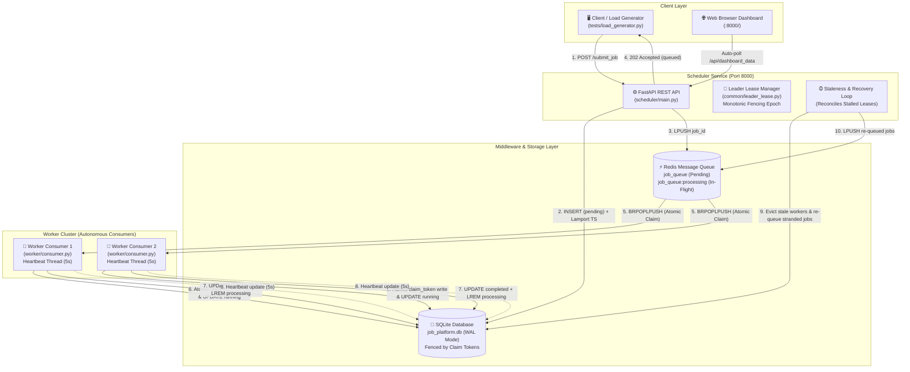

# Distributed Background Job Processing Platform

> **A production-grade, fault-tolerant distributed background job execution platform demonstrating core Distributed Systems principles and emerging paradigms.**

[](https://www.python.org/)
[](https://fastapi.tiangolo.com/)
[](https://redis.io/)
[](https://www.sqlite.org/)
[](tests/)
[](LICENSE)

---

## 📖 Overview

The **Distributed Job Platform** is an extensible, educational, and production-patterned distributed system designed to demonstrate core concepts in modern distributed computing. 

It implements:
* **Asynchronous Message-Oriented Middleware** (Redis `BRPOPLPUSH` reliable queue with at-least-once delivery guarantees).
* **Fault-Tolerant Scheduling & Crash Recovery** (Worker heartbeat liveness monitoring, automatic task reclamation, and dead-letter queueing).
* **Safety & Concurrency Hardening** (Redis-backed leader leases, monotonic fencing tokens, claim-token fenced database mutations, and SQLite WAL concurrency).
* **Distributed Synchronization (Unit III)** (Lamport Clocks, Vector Clocks, Cristian's Algorithm, Garcia-Molina Bully Election, Chang-Roberts Ring Election, Lamport Distributed Mutual Exclusion, Chandy-Lamport Distributed Snapshots, Wait-For Graph Deadlock Detection, and Beacon Protocol).
* **Emerging Paradigms (Unit IV)** (Remote Object & Proxy/Servant pattern, Web-based REST asynchronous pipelines, Distributed File System simulation with block replication & autonomous re-replication, Serverless FaaS runtime with process-isolated execution & timeout enforcement, and comprehensive Industrial Case Studies).

---

## ⚡ Quick Start (< 2 Minutes)

### 1. Prerequisites & Setup
Clone the repository, create a virtual environment, and install dependencies:

```bash
# Clone the repository
git clone https://github.com/SwayamMandhani06/distributed-job-platform.git
cd distributed-job-platform

# Create and activate virtual environment
python -m venv venv

# Windows PowerShell:
.\venv\Scripts\activate
# Linux / macOS:
source venv/bin/activate

# Install required packages
pip install -r requirements.txt
```

### 2. Start Redis Server

* **Option A: Bundled Portable Redis (Windows)**
  ```powershell
  .\tools\redis\redis-server.exe .\tools\redis\redis.windows.conf
  ```

* **Option B: Docker (Cross-Platform)**
  ```bash
  docker run -d --name redis-server -p 6379:6379 redis:latest
  ```

* **Option C: Native Linux / macOS Service**
  ```bash
  sudo systemctl start redis-server  # Ubuntu/Debian
  brew services start redis         # macOS
  ```

Verify Redis is running:
```bash
redis-cli ping  # Returns PONG
```

---

### 3. Launch the Platform Services

Open separate terminals (with `venv` activated in each):

#### Terminal 1 — Start Coordinator & Live Web Dashboard
```bash
python -m uvicorn scheduler.main:app --port 8000 --reload
```
* 🌐 **Live Web Dashboard:** [http://localhost:8000/](http://localhost:8000/)
* 📑 **Interactive OpenAPI Documentation:** [http://localhost:8000/docs](http://localhost:8000/docs)

#### Terminal 2 — Start Worker Consumer
```bash
python -m worker.consumer
```
*(You can launch multiple worker processes across multiple terminals; Redis will dynamically load-balance tasks across all active consumers).*

#### Terminal 3 — Submit Workloads (Demo Load Generator)
```bash
# Submit 15 sample jobs spaced at 0.5s intervals
python -m tests.load_generator --count 15 --interval 0.5
```

---

## 🏛️ System Architecture



---

## 📁 Repository Structure

```
distributed-job-platform/
├── common/                               # Core shared infrastructure & distributed systems modules
│   ├── beacon_protocol.py                # Beacon Protocol & failure detector (diamond-P model)
│   ├── clocks.py                         # Lamport Logical Clocks & Mattern/Fidge Vector Clocks
│   ├── config.py                         # Centralized configuration & environment settings
│   ├── cristian.py                       # Cristian's Physical Clock Synchronization algorithm
│   ├── database.py                       # SQLite persistence layer with claim-token & epoch fencing
│   ├── deadlock_wfg.py                   # Centralized Wait-For Graph (WFG) deadlock detection
│   ├── distributed_filesystem.py         # Distributed File System (DFS) simulation with replication
│   ├── distributed_object.py             # Remote Object Proxy/Servant pattern with allowlisting
│   ├── election_bully.py                 # Garcia-Molina Bully Leader Election algorithm
│   ├── election_ring.py                  # Chang-Roberts Logical Ring Leader Election algorithm
│   ├── leader_lease.py                   # Redis-backed leader leases & monotonic fencing epochs
│   ├── logging_config.py                 # Shared structured logging utilities
│   ├── mutual_exclusion.py               # Lamport Distributed Mutual Exclusion simulation
│   ├── queue_client.py                   # Reliable Redis queue wrapper (BRPOPLPUSH pattern)
│   ├── serverless_runtime.py             # Serverless FaaS runtime with process isolation & timeouts
│   └── snapshot_chandy_lamport.py        # Chandy-Lamport Distributed Snapshot simulation
├── scheduler/                            # Coordinator service & Web UI
│   ├── main.py                           # FastAPI application & background reconciler
│   ├── models.py                         # Pydantic request/response schemas
│   └── templates/
│       └── dashboard.html                # Real-time dark-mode monitoring dashboard
├── worker/                               # Compute worker engine
│   ├── consumer.py                       # Autonomous consumer loop with daemon heartbeat thread
│   └── handlers.py                       # Modular task handlers (email, prime sieve, hashing, etc.)
├── tests/                                # Comprehensive automated test suite
│   ├── load_generator.py                 # Workload simulation & benchmark tool
│   ├── test_client.py                    # End-to-end integration test
│   ├── test_clocks_and_sync.py           # Lamport, Vector, and Cristian clock tests
│   ├── test_elections_and_leases.py      # Bully, Ring, and Leader Lease tests
│   ├── test_handlers.py                  # Worker task handler unit tests
│   ├── test_mutual_exclusion.py          # Lamport Distributed Mutex tests
│   ├── test_recovery_and_queue.py        # Queue reliability, recovery & dead-letter tests
│   ├── test_reliability_hardening.py     # Stale worker eviction & token fencing tests
│   ├── test_scheduler_worker.py          # Scheduler API endpoints & database timeout tests
│   ├── test_unit3_advanced.py            # Chandy-Lamport, WFG Deadlock, and Beacon tests
│   └── test_unit4_emerging_paradigms.py  # Unit IV Remote Object, DFS, and Serverless tests
├── tools/                                # Standalone interactive CLI demonstrations
│   ├── beacon_protocol_demo.py           # Beacon failure detection demo
│   ├── bully_election_demo.py            # Bully election simulation demo
│   ├── deadlock_detection_demo.py        # Wait-For Graph deadlock detection demo
│   ├── demonstrate_crash_recovery.py     # Fault-injection & crash recovery demo
│   ├── dfs_simulation_demo.py            # DFS block replication & failover demo
│   ├── mutex_lamport_demo.py             # Lamport mutual exclusion demo
│   ├── remote_object_demo.py             # Remote object proxy invocation demo
│   ├── ring_election_demo.py             # Ring election simulation demo
│   ├── serverless_function_demo.py       # Serverless cold start & timeout demo
│   ├── snapshot_chandy_lamport_demo.py   # Chandy-Lamport snapshot demo
│   ├── sync_cristian.py                  # Cristian physical clock sync demo
│   ├── vector_clock_demo.py              # Vector clock causality demo
│   └── web_architecture_demo.py          # Web distributed request flow demo
├── docs/                                 # Academic documentation & deep dives
│   └── CASE_STUDIES.md                   # Industrial Case Studies (Megaport, Cloudflare, AWS, etc.)
├── ARCHITECTURE.md                       # Detailed technical design & theoretical mapping
├── DEMO_SCRIPT.md                        # Step-by-step viva presentation playbook
├── requirements.txt                      # Pinned Python package dependencies
├── .env.example                          # Environment variable configuration template
├── .gitignore                            # Comprehensive git ignore rules
└── LICENSE                               # MIT License
```

---

## 🛡️ Reliability & Fault-Tolerance Guarantees

1. **At-Least-Once Delivery**:
   Workers pop jobs using `BRPOPLPUSH`, atomically transferring identifiers from `job_queue` into `job_queue:processing`. A task is never lost if a consumer crashes mid-execution.
2. **Claim-Token Fencing**:
   Every job claim generates a unique UUID `claim_token`. Database mutations (`running` $\rightarrow$ `completed` or `failed`) enforce `WHERE claim_token = :token`. If a worker is declared dead and its job is re-assigned, any delayed write from the zombie worker is definitively rejected.
3. **Monotonic Leader Fencing Epochs**:
   Coordinators elect leadership backed by Redis leases. Every lease acquisition increments a monotonic epoch. Authoritative database writes enforce `WHERE leader_epoch >= :last_seen_epoch`, preventing split-brain writes during garbage collection pauses or transient network partitions.
4. **Autonomous Crash Recovery**:
   The background staleness monitor inspects heartbeat timestamps. If a worker fails to ping within 15 seconds, it is marked `offline` and its in-flight jobs are safely re-queued or routed to the Dead-Letter Queue (DLQ) if retry limits are exceeded.

---

## 🔬 Syllabus Concepts: Unit III — Synchronization

| Topic | Concept / Algorithm | Implementation Module | Interactive Demo CLI | Theoretical Guarantees |
|---|---|---|---|---|
| **Physical Clock Synchronization** | **Cristian's Algorithm** | [`common/cristian.py`](common/cristian.py) | `python -m tools.sync_cristian` | Skew calculation $\theta = T_s + \frac{RTT}{2} - T_c$ with physical network jitter compensation. |
| **Logical Clocks** | **Lamport Logical Clocks** | [`common/clocks.py`](common/clocks.py) | Embedded in all APIs | Monotonic scalar ordering: $L_i = \max(L_i, L_{msg}) + 1$, guaranteeing causal partial order. |
| **Vector Clocks** | **Mattern & Fidge Vector Clocks** | [`common/clocks.py`](common/clocks.py) | `python -m tools.vector_clock_demo` | Causal tracking identifying concurrent vs. causally preceding events ($V_A < V_B$ vs $V_A \parallel V_B$). |
| **Global State & Snapshots** | **Chandy-Lamport Algorithm** | [`common/snapshot_chandy_lamport.py`](common/snapshot_chandy_lamport.py) | `python -m tools.snapshot_chandy_lamport_demo` | Marker-based consistent cuts capturing process states and in-flight channel messages without halting execution. |
| **Leader Election** | **Bully Election (Garcia-Molina)** | [`common/election_bully.py`](common/election_bully.py) | `python -m tools.bully_election_demo` | Highest active ID assumes leadership; handles coordinator crash and re-election. |
| **Leader Election** | **Ring Election (Chang & Roberts)** | [`common/election_ring.py`](common/election_ring.py) | `python -m tools.ring_election_demo` | Message circulation in a logical ring with automatic dead-successor bypass. |
| **Mutual Exclusion** | **Lamport Distributed Mutex** | [`common/mutual_exclusion.py`](common/mutual_exclusion.py) | `python -m tools.mutex_lamport_demo` | Total ordering $(L_i, P_i)$ with $3(N-1)$ message complexity and dead-node eviction under $\mathcal{P}$. |
| **Deadlock Detection** | **Wait-For Graph (WFG) Detector** | [`common/deadlock_wfg.py`](common/deadlock_wfg.py) | `python -m tools.deadlock_detection_demo` | Centralized DFS 3-color cycle detection finding circular dependencies with victim preemption. |
| **Failure Detection** | **Beacon Protocol** | [`common/beacon_protocol.py`](common/beacon_protocol.py) | `python -m tools.beacon_protocol_demo` | Periodic heartbeat beaconing, sliding observation windows, suspect/dead thresholds ($\diamond\mathcal{P}$). |

---

## 🌐 Syllabus Concepts: Unit IV — Emerging Paradigms

| Topic | Paradigm / Model | Implementation Module | Interactive Demo CLI | Architectural Guarantees |
|---|---|---|---|---|
| **Distributed Object Systems** | **Remote Object Proxy & Servant** | [`common/distributed_object.py`](common/distributed_object.py) | `python -m tools.remote_object_demo` | Transparent proxy stubs, network marshalling, strict method allowlisting (private/dunder rejection), and timeout enforcement. |
| **Web-Based Distributed Systems** | **RESTful Asynchronous Architecture** | [`scheduler/main.py`](scheduler/main.py) | `python -m tools.web_architecture_demo` | HTTP 202 Accepted intake, decoupled queue processing, idempotency tokens, and real-time observability. |
| **Distributed File Systems** | **Decoupled Metadata & Chunk Storage** | [`common/distributed_filesystem.py`](common/distributed_filesystem.py) | `python -m tools.dfs_simulation_demo` | NameNode metadata registry vs. DataNode blocks, SHA-256 integrity verification, $R=2$ replication, and autonomous re-replication on node failure. |
| **Serverless Computing** | **Event-Driven FaaS Runtime** | [`common/serverless_runtime.py`](common/serverless_runtime.py) | `python -m tools.serverless_function_demo` | Ephemeral lifecycle with true OS process isolation, cold vs. warm start metrics, strict execution timeout termination, and idempotency caching. |
| **Industrial Case Studies** | **Megaport, Cloudflare, AWS, Hadoop, Kubernetes, HDFS** | [`docs/CASE_STUDIES.md`](docs/CASE_STUDIES.md) | [Read Case Studies](docs/CASE_STUDIES.md) | Comprehensive production analysis covering SDN fabrics, Anycast CDNs, DynamoDB Paxos, Aurora quorums, MapReduce, and Raft consensus. |

---

## 🧪 Automated Testing

The repository includes a comprehensive, regression-tested test suite with **140 automated tests** covering all units.

To run the entire test suite:
```bash
pytest -v
```

To run unit-specific test files:
```bash
# Unit III Clocks & Synchronization
pytest tests/test_clocks_and_sync.py -v

# Unit III Advanced (Snapshots, Deadlock WFG, Beacon)
pytest tests/test_unit3_advanced.py -v

# Unit III Elections & Leader Leases
pytest tests/test_elections_and_leases.py -v

# Unit IV Emerging Paradigms (Remote Objects, DFS, Serverless)
pytest tests/test_unit4_emerging_paradigms.py -v

# Queue Reliability, Crash Recovery & Fencing
pytest tests/test_reliability_hardening.py -v
```

---

## 📡 Key REST API Endpoints

| Method | Endpoint | Description |
|---|---|---|
| `GET` | `/` | Serves the single-page live web dashboard |
| `GET` | `/health` | Health check endpoint returning coordinator, worker, and queue status |
| `POST` | `/submit_job` | Submits a new background task (returns HTTP 202 Accepted with `job_id`) |
| `GET` | `/jobs/{job_id}` | Fetches current execution state, retry count, worker, and result |
| `GET` | `/api/dashboard_data` | Live JSON feed powering the frontend dashboard polling loop |
| `GET` | `/api/time` | Microsecond server timestamp used for Cristian's Clock Synchronization |
| `GET` | `/api/leader` | Current leader status, epoch number, and remaining lease TTL |

---

## 📜 Documentation & Evaluation Resources

* 📑 **[System Architecture (ARCHITECTURE.md)](ARCHITECTURE.md)**: Deep dive into design trade-offs, schemas, and theoretical mappings.
* 🎬 **[Live Presentation Script (DEMO_SCRIPT.md)](DEMO_SCRIPT.md)**: Turn-by-turn presentation playbook for viva defense and live demos.
* 📚 **[Industrial Case Studies (docs/CASE_STUDIES.md)](docs/CASE_STUDIES.md)**: Rigorous case studies with academic citations covering AWS, Cloudflare, Megaport, Hadoop, and Kubernetes.
* ⚙️ **[Environment Template (.env.example)](.env.example)**: All customizable system parameters.

---

## 📄 License

This project is licensed under the MIT License — see the [LICENSE](LICENSE) file for details.
