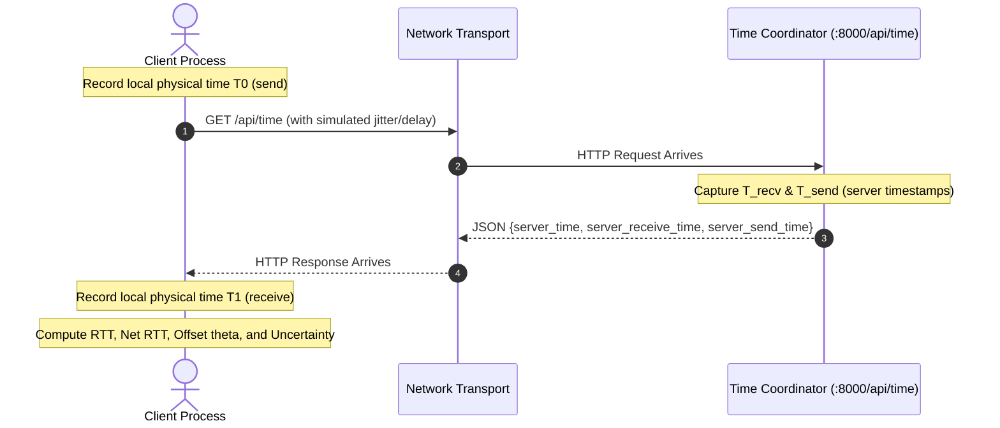
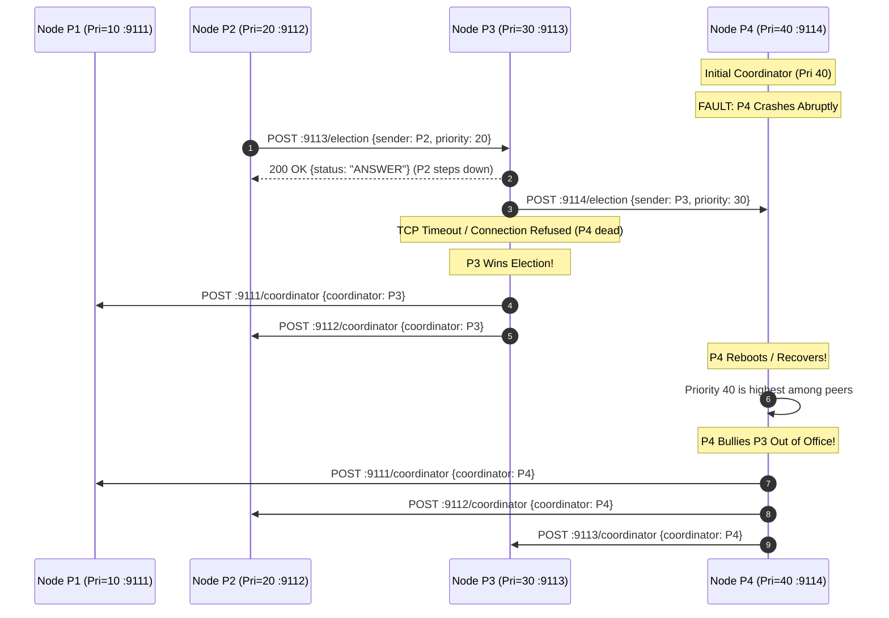

# Distributed Clocks, Leader Elections & Coordination Specification

> **Phase 3 Technical Specification: Formal analysis and verification of Cristian's Physical Synchronization, Lamport Logical Clocks, Vector Clocks, Multi-Process Bully & Ring Elections, and Leader Lease Fencing Integration.**

---

## 1. Cristian's Physical Clock Synchronization (Flaviu Cristian, 1989)

### Theoretical Model
In an asynchronous distributed system without synchronized hardware oscillators, Cristian's algorithm synchronizes a client process's clock with a centralized time server over a network.



### Mathematical Formulation
- **Total Round-Trip Time ($RTT_{total}$)**:
  $$RTT_{total} = T_1 - T_0$$
- **Server Internal Turnaround ($I$)**:
  $$I = T_{server\_send} - T_{server\_receive}$$
- **Isolated Network Round-Trip ($RTT_{net}$)**:
  $$RTT_{net} = \max(0, RTT_{total} - I)$$
- **Estimated Server Time at Client Receive ($T_{est}$)**:
  $$T_{est} = T_{server\_send} + \frac{RTT_{net}}{2}$$
- **Estimated Clock Offset ($\theta$)**:
  $$\theta = T_{est} - T_1 = T_{server\_send} + \frac{RTT_{net}}{2} - T_1$$
- **Uncertainty Bound ($U$)**:
  $$U = \pm \frac{RTT_{net}}{2}$$

### Crucial Architectural Distinction: Software Offset vs OS Clock Modification
- **Simulated / Software Offset**: The client calculates $\theta$ and provides synchronized timestamps via `current_sync_time = local_time + theta`.
- **Actual OS Clock Modification**: Modifying the operating system's hardware or kernel physical clock (via `SetSystemTime` or `settimeofday`) requires root/administrator privileges and is **deliberately avoided**. Arbitrarily jumping the machine clock backward causes clock regressions that destabilize event loops, timeouts, TLS validation, and operating-system thread scheduling.

### Fault Injection & Error Handling
The client implementation (`tools/sync_cristian.py` and `common/cristian.py`) includes:
- `--delay <seconds>`: Injected outbound and inbound transit delay.
- `--jitter <seconds>`: Injected stochastic network jitter.
- `--local-offset <seconds>`: Injected simulated client clock drift.
- Rejection of non-monotonic timestamps ($T_1 < T_0$), malformed JSON, and server timeouts.

---

## 2. Lamport Logical Clocks & Causal Ordering (Leslie Lamport, 1978)

### Event Rules
1. **Local Event / Message Send**: Before an internal event or before transmitting a message, process $P_i$ increments its local clock:
   $$L_i = L_i + 1$$
2. **Message Receipt**: Upon receiving a message with timestamp $T_{msg}$, process $P_j$ updates:
   $$L_j = \max(L_j, T_{msg}) + 1$$

### Integration into Scheduler & Worker Workflow
1. **Job Submission**: Coordinator captures $L_{sched} = \text{send\_event}()$, persists $L_{sched}$ in PostgreSQL/SQLite `jobs.lamport_ts`, and records a trace event: `(scheduler, job_submitted, L_sched)`.
2. **Worker Claim**: Consumer receives $L_{sched}$, updates $L_{worker} = \max(L_{worker}, L_{sched}) + 1$, and records: `(worker, job_claimed, L_worker)`.
3. **Execution**: Worker ticks locally during execution.
4. **Completion**: Worker increments $L_{comp} = \text{send\_event}()$, persists $L_{comp}$ with claim fencing, and records: `(worker, job_completed, L_comp)`.

### Causal Ordering Verification
For any causally related events $e_a \to e_b$:
$$L(e_a) < L(e_b)$$
Exposed via the coordinator REST endpoint:
```http
GET http://localhost:8000/api/clocks/lamport_trace
```

---

## 3. Vector Clocks & Concurrency Detection (Fidge & Mattern, 1988)

### Model & Comparison Semantics
In a system of $N$ processes, each process maintains a vector $V = [c_1, c_2, \dots, c_N]$.
- **$V_1 < V_2$ (BEFORE)**: $\forall k: V_1[k] \le V_2[k]$ and $\exists k: V_1[k] < V_2[k]$ ($V_1$ causally precedes $V_2$).
- **$V_1 > V_2$ (AFTER)**: $V_2 < V_1$.
- **$V_1 == V_2$ (EQUAL)**: $\forall k: V_1[k] == V_2[k]$.
- **$V_1 \parallel V_2$ (CONCURRENT)**: Neither $V_1 < V_2$ nor $V_2 < V_1$. Independent concurrent events!

### Explicit Membership Management
Vector clocks are strictly bounded by process dimensionality. Silently unioning missing keys with zeros across vectors can obscure process membership changes.
The platform implements explicit membership controls:
- `add_member(process_id)`: Explicitly registers a new process in the vector space.
- `remove_member(process_id)`: Explicitly retires a departed process.
- `compare(v1, v2, strict_membership=True)`: Rejects comparisons between vectors with unequal process spaces with a `ValueError`.

### Inter-Process Exchange Endpoint
Independent processes exchange and merge vectors via HTTP:
```http
POST http://localhost:8000/api/clocks/vector/exchange
Content-Type: application/json

{"sender_id": "worker-node-1", "vector": {"worker-node-1": 4, "scheduler": 2}}
```

---

## 4. Multi-Process Leader Elections (Real TCP Network Transport)

### A. Garcia-Molina Bully Election (1982)
The Bully algorithm elects the active process with the highest priority/ID. Higher-priority processes always override and take leadership from lower-priority processes.



### B. Chang & Roberts Logical Ring Election
Organized in a logical unidirectional ring: $P_1 \to P_2 \to P_3 \to P_4 \to P_1$.
- **Token Circulation**: Initiator sends `[ (initiator, priority) ]` to successor. Successors append themselves and forward.
- **Completion**: When token returns to initiator, candidate with maximum priority is declared coordinator.
- **Successor Failure Bypass**: When forwarding, if a node's immediate successor is dead (connection refused or socket timeout), the node **skips the dead successor** and forwards to the next living node in ring order.

---

## 5. Leader Lease Fencing & Operational Recovery (Section E)

### The Fencing Problem
In an asynchronous distributed system:
1. Leader A acquires a 5-second Redis lease with Epoch 1.
2. Leader A encounters a stop-the-world pause (GC pause, VM freeze, or network partition).
3. Lease expires in Redis.
4. Leader B acquires the lease, increments the fencing epoch to 2, and performs authoritative recovery.
5. Leader A wakes up believing it is still leader. If Leader A performs writes without epoch validation, data would be corrupted.

### Atomic Fencing Guarantee
- Every authoritative mutation (stale job reclamation, worker staleness marking, queue reconciliation) calls `validate_and_record_leader_epoch(conn, leader_id, epoch)`.
- If `caller_epoch < durable_epoch`:
  - `StaleLeaderError` is immediately raised.
  - The transaction rolls back.
  - The stale leader steps down immediately (`lease_mgr.step_down()`).
- Before re-dispatching recovered work to Redis, the scheduler verifies:
  `if not lease_mgr.is_leader or lease_mgr.current_epoch != leader_epoch: abort`.

### Redis Disconnect & Lease Failure
If Redis becomes unreachable or lease renewal fails (`res == 0`), `LeaderLeaseManager` immediately sets `is_leader = False`, halting all leader-owned recovery loops.

---

## 6. Verification Commands & Test Reproduction

```bash
# 1. Run multi-process Bully election demo (4 independent HTTP nodes on ports 9111-9114):
python -m tools.bully_multiprocess_demo

# 2. Run multi-process Ring election demo (4 nodes on ports 9211-9214 with dead successor bypass):
python -m tools.ring_multiprocess_demo

# 3. Run live Cristian clock synchronization with injected delay & jitter:
python -m tools.sync_cristian --url http://localhost:8000 --delay 0.05 --jitter 0.01 --local-offset 2.5

# 4. Run automated unit and multi-process election test suite:
pytest tests/test_clocks_and_sync.py -v
pytest tests/test_multiprocess_elections.py -v

# 5. Run full test suite across entire repository (169 tests):
pytest tests/
```
