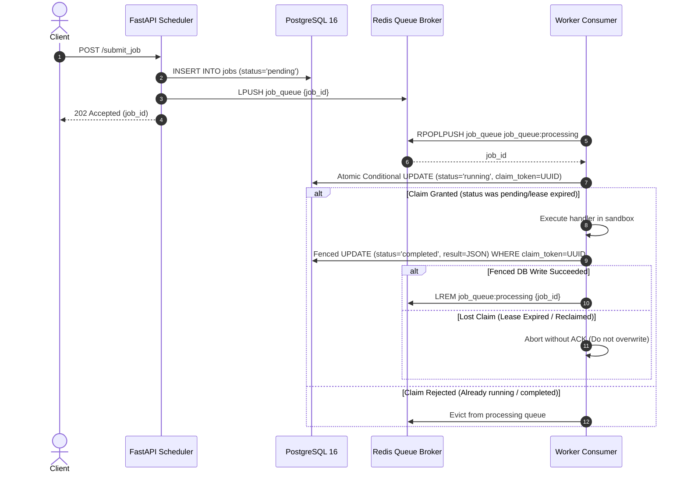

# Redis Durability, Delivery Guarantees & Fault Tolerance Specification

> **Phase 2 Technical Specification: Analysis of the Distributed Job Platform's Queue Delivery, Durability Assumptions, Failure Recovery, and Fencing Primitives.**

---

## 1. Executive Summary: The Dual-Storage Reliability Model

In our distributed job platform, storage responsibilities are strictly decoupled:

1. **PostgreSQL 16 (Authoritative Metadata Store)**:
   - Single source of truth for job lifecycle states, payloads, execution outputs, worker heartbeat liveness, and leader fencing epochs.
   - Guarantees ACID transactions, row-level locking, and durable point-in-time recovery.
2. **Redis 7 (Low-Latency Message Broker & Coordination Tier)**:
   - Ephemeral transit tier for job dispatching (`job_queue`), reliable delivery tracking (`job_queue:processing`), distributed leader leases, and mutex primitives.
   - Configured with Append-Only File (AOF) persistence (`appendfsync everysec`) and periodic RDB snapshots.

### Crucial Architectural Truth: No Cross-System 2PC
There is **no distributed two-phase commit (2PC) or cross-system atomicity** between PostgreSQL and Redis. Network partitions, power outages, and process crashes can occur between a Redis queue operation and a PostgreSQL write. 

To maintain consistency without pretending cross-system atomicity exists, the system enforces **at-least-once delivery with unidirectional dependency ordering**:
- **Durable writes always precede queue state mutations.**
- **PostgreSQL state is always authoritative; Redis queue state is recoverable from PostgreSQL.**
- **All state transitions are fenced with unique claim tokens to eliminate duplicate execution races.**

---

## 2. Job Delivery Lifecycle & State Machine



### Detailed Transition Steps:
1. **Submission**:
   - `insert_job()` commits the job record with `status='pending'` to PostgreSQL.
   - `queue.enqueue_job(job_id)` pushes `job_id` to the tail of `job_queue`.
2. **Atomic Dispatch**:
   - Worker executes `RPOPLPUSH job_queue job_queue:processing`. The item is atomically popped from the pending queue and placed into the in-flight processing queue.
3. **Durable Claim & Fencing**:
   - Worker calls `claim_job_for_worker(job_id, worker_id, lease_seconds=30.0)`.
   - The query uses conditional SQL:
     ```sql
     UPDATE jobs
     SET status = 'running',
         worker_id = %s,
         claimed_at = %s,
         lease_expires_at = %s,
         claim_token = %s,
         retry_count = retry_count + 1,
         lamport_ts = GREATEST(lamport_ts, %s) + 1
     WHERE job_id = %s
       AND (
           status IN ('pending', 'queued')
           OR (status = 'running' AND lease_expires_at IS NOT NULL AND lease_expires_at < %s)
       )
     ```
   - Only **one** worker successfully claims the job and acquires the unique `claim_token`.
4. **Execution**:
   - The worker executes the registered handler with real execution duration tracking.
5. **Durable Fenced Persistence**:
   - On completion, the worker calls `update_job_status(job_id, "completed", claim_token=claim_token)`.
   - The update is strictly fenced:
     ```sql
     UPDATE jobs
     SET status = 'completed',
         completed_at = %s,
         result = %s,
         claim_token = NULL,
         lease_expires_at = NULL
     WHERE job_id = %s
       AND status = 'running'
       AND claim_token = %s
     ```
6. **Queue Acknowledgement**:
   - **Only after** the fenced PostgreSQL update returns `rowcount > 0` does the worker call `queue.ack_job(job_id, claim_token=claim_token)` which executes `LREM job_queue:processing 1 job_id`.

---

## 3. Redis Persistence Configuration & Durability Modes

In `docker-compose.yml`, the Redis service is configured as:
```yaml
command: >
  redis-server
  --appendonly yes
  --appendfsync everysec
  --save 900 1
  --save 300 10
  --save 60 1000
```

### Durability Guarantees Across Failure Modes

| Failure Mode | Direct Impact on Redis | Maximum Data Lost | Recovery Mechanism |
| :--- | :--- | :--- | :--- |
| **Clean Redis Restart** (`docker compose restart redis`) | Redis flushes all buffers and writes clean AOF on shutdown. | **Zero** data loss. | Redis restarts, loads AOF file from persistent volume `redis_data`, all queues remain intact. |
| **Unclean Redis Crash / Host Power Cut** | In-flight writes in OS page cache may not have been fsynced. | At most **1.0 second** of Redis queue mutations. | PostgreSQL holds authoritative state. Scheduler `stale_job_recovery_loop` detects pending jobs or stranded leases and re-enqueues them. |
| **Catastrophic Redis Volume Loss** (`rm -rf redis_data`) | All in-memory and AOF data wiped. | Ephemeral transit queues wiped. | **Zero permanent data loss**. PostgreSQL holds authoritative records. Scheduler recovery sweep queries `SELECT job_id FROM jobs WHERE status = 'pending'` and re-populates `job_queue`. |
| **Worker Process Crash Mid-Execution** | Job remains stranded in `job_queue:processing`. | Zero data loss. | Lease expires after 30s. Scheduler recovery loop resets job to `pending` (if `retry_count < 3`) or `dead_letter` (if retries exhausted), then re-enqueues. |
| **Network Partition (Split-Brain Worker)** | Worker continues executing slowly while lease expires and another worker re-claims. | Zero data corruption. | Stale worker's completion query fails against PostgreSQL due to `claim_token` mismatch (`rowcount=0`). Stale worker's output is discarded. |

---

## 4. Reconciliation: Preventing Stranded Queue Items

If a worker crashes after persisting completion to PostgreSQL but before calling `queue.ack_job()`, or if the scheduler was restarted during job dispatch:

The scheduler runs an autonomous **reconciliation loop** (`reconcile_processing_queue`):
```python
# scheduler/main.py -> stale_job_recovery_loop()
processing_items = queue.get_processing_jobs()
actions = reconcile_processing_queue(processing_items, leader_epoch=epoch)
for rec in actions:
    jid = rec["job_id"]
    if rec["action"] == "evict":
        # Job already completed/failed in PostgreSQL -> safe to evict from Redis
        queue.remove_from_processing(jid)
    elif rec["action"] == "requeue":
        # Job still pending in PostgreSQL -> re-insert into pending queue
        queue.requeue_job(jid)
```

This guarantees that:
- **No job is stranded indefinitely in `job_queue:processing`.**
- **Completed jobs are purged from the queue broker without repeated executions.**
- **Stranded pending jobs are returned to the active work queue.**

---

## 5. Retry Conventions & Dead-Letter Failsafe

- `MAX_JOB_RETRIES = 3`:
  - Attempt 1: Initial claim.
  - Attempt 2: First recovery retry after lease timeout or worker crash.
  - Attempt 3: Final recovery retry.
- Once `retry_count >= MAX_JOB_RETRIES`, the recovery sweeper permanently transitions the job to `status='dead_letter'`, recording the root cause and timestamps in PostgreSQL.
- Dead-letter jobs are accessible via `GET /jobs` and `get_dead_letter_jobs()` for manual audit, diagnostic replay, or administrative triage.
